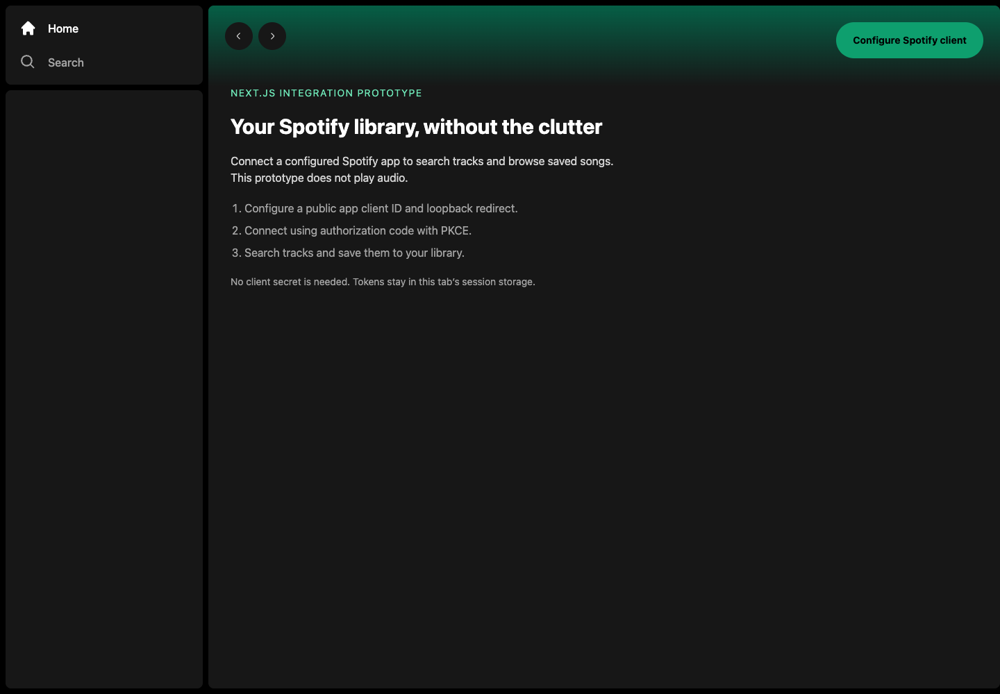
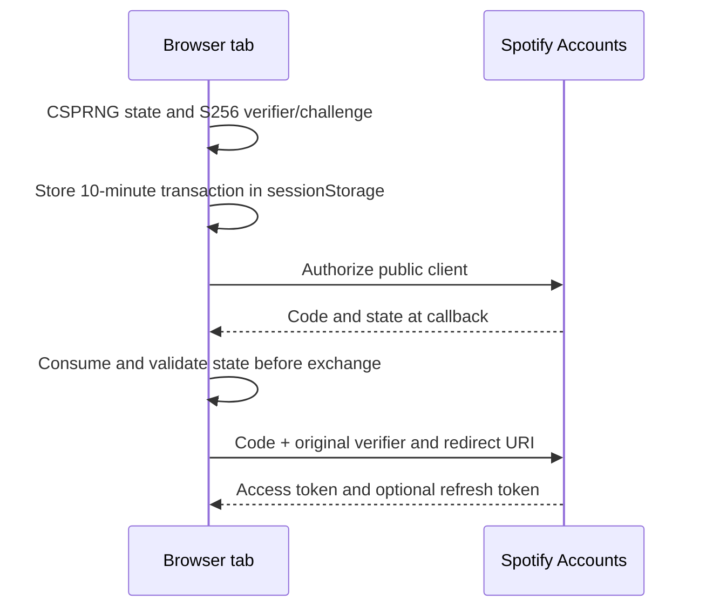

# Spotify library browser

A Next.js 14 prototype for Spotify track search, saved-library browsing and saving tracks to the current user's library. Despite the repository name and unused playback dependency, the implemented UI **does not play audio**. There is no server-side session or NextAuth integration.



[390px mobile view](docs/screenshots/mobile.png)

## Run the disconnected interface

Use Node 22 and pnpm 8, matching the committed v6 lockfile:

```sh
pnpm install --frozen-lockfile --ignore-scripts
cp .env.example .env.local
pnpm dev --hostname 127.0.0.1
```

Open `http://127.0.0.1:3000`. Without a client ID, the interface explains setup and disables connection. Public environment variables are compiled into the browser bundle; **never add a client secret**.

For intentional provider testing, register your own public Spotify client and the exact redirect `http://127.0.0.1:3000/callback`. Set `NEXT_PUBLIC_SPOTIFY_CLIENT_ID` and `NEXT_PUBLIC_APP_URL`, then restart/rebuild. Spotify requires HTTPS or an explicit loopback IP for redirects; `localhost` is not accepted under its [current redirect requirements](https://developer.spotify.com/documentation/web-api/concepts/redirect_uri). Provider access, app restrictions and account eligibility have not been verified with a live account.

## Authentication boundary



The [authorization-code PKCE flow](https://developer.spotify.com/documentation/web-api/tutorials/code-pkce-flow) needs no browser client secret. State is tab-bound, expires after ten minutes and is consumed once. Requests go to fixed Spotify HTTPS origins, use a 15-second timeout and retry an original API request once after a 401/refresh. Other HTTP failures do not trigger token refresh. An omitted rotated refresh token preserves the previous one.

Tokens remain readable to JavaScript in session storage; this reduces persistence but does not protect against XSS. Older local-storage tokens are purged. Logout clears local browser tokens and pending state; it does not revoke the provider grant. A server-side HttpOnly session would require a separate architecture change.

## UI and source

- `app/(home)/page.tsx`: disconnected introduction and initial track results.
- `app/search/page.tsx`: debounced search; stale responses are ignored and failures clear loading state.
- `contexts/LibraryContext.tsx`: saved tracks, save action and visible load/save errors.
- `utils/auth.utils.ts` and `services/`: PKCE, tab session, token exchange and API requests.

Navigation and save icons have button labels. Missing artwork uses a local SVG. The interface remains a prototype: saved tracks are sidebar-only on desktop, there is no library pagination or audio control, and broader component accessibility needs further review. Several legacy dependencies/configuration files are unused; they do not establish Firebase, Redux or NextAuth features.

## Verification

```sh
pnpm test
pnpm build --no-lint
pnpm start --hostname 127.0.0.1
```

Nine offline Node tests pass for S256/state, expiry/one-use behavior, secret-free exchange, refresh preservation, bounded retry and logout. The Next.js production build/type check passes; lint was explicitly skipped because this repository has no committed lint configuration. Chrome/Playwright verified the disconnected desktop/mobile layouts, missing-config guard, legacy-token purge, reactive logout with mocked API responses, and bad-state callback rejection before a provider request.

No real Spotify login, saved tracks, account information or playback was used. The screenshots show the disconnected production build. Live OAuth consent, account/app restrictions, actual search/save behavior and provider-side revocation remain unverified. The historical README credential was removed from reachable history; its owner must rotate it if it was real. Successful local checks are not a claim of a working live Spotify integration.
