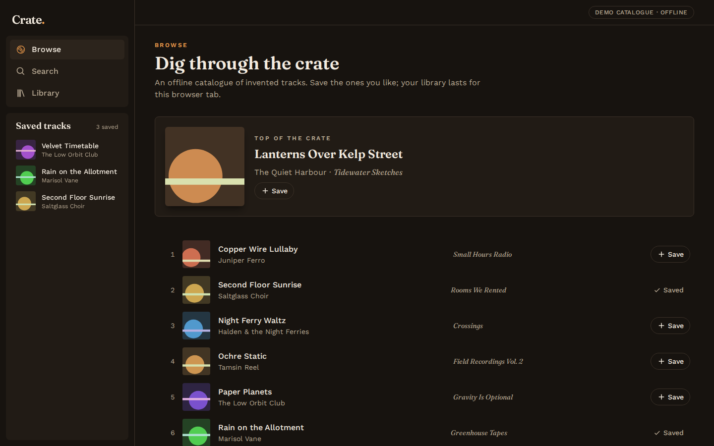
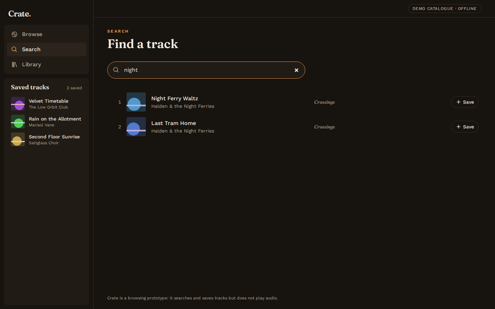
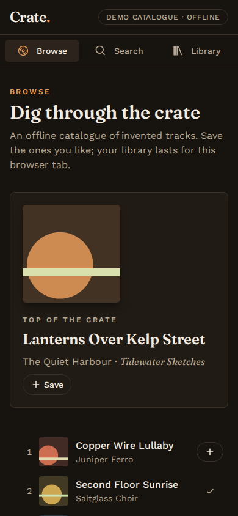
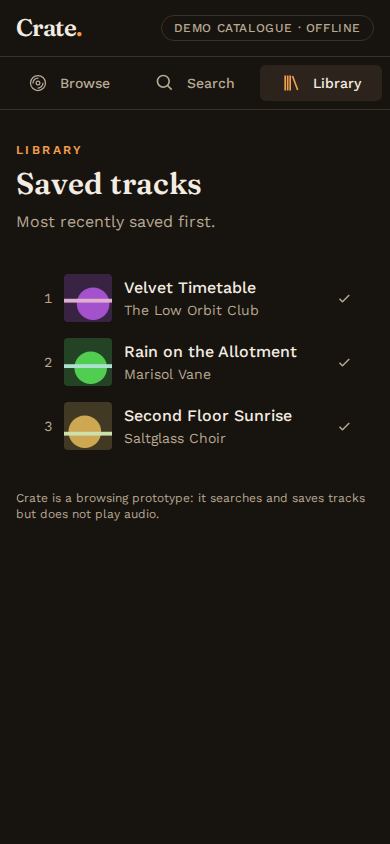
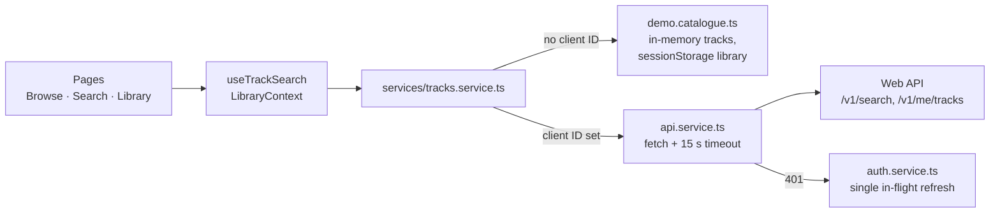
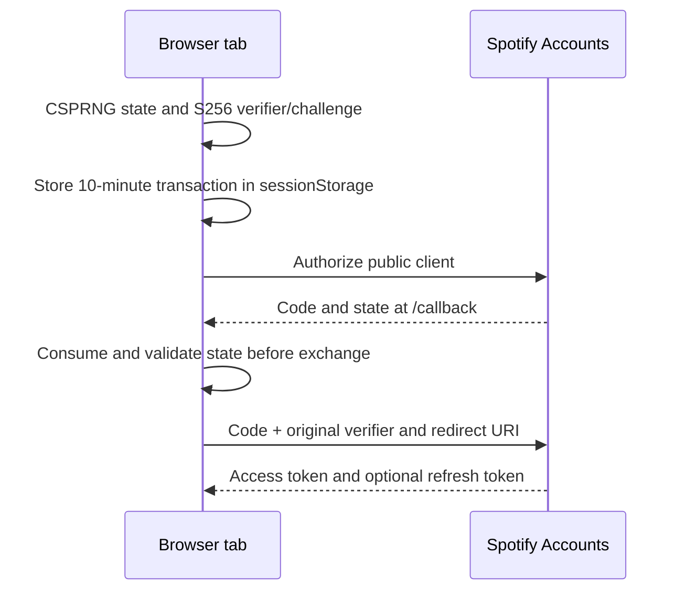

# Crate

A Next.js music-library browser: search tracks, keep a saved library and flick through a catalogue in a tracklist layout. It is a UI prototype and **does not play audio**. There is no player, no streaming and no playback controls, despite the repository name.

Out of the box it runs on an offline demo catalogue of sixteen invented tracks, so you can try every screen without an account or network access. Optionally, it can connect to a Spotify account through a browser-only OAuth flow (authorization code with PKCE) and use the same screens against the live Web API.



| Search | Mobile browse | Mobile library |
| --- | --- | --- |
|  |  |  |

All tracks, artists and albums in the screenshots are fictional, and the artwork is drawn locally as SVG.

## Run it

Requires Node 22 (see `.nvmrc`) and pnpm 10, which Corepack provides from the `packageManager` field.

```sh
corepack enable
pnpm install --frozen-lockfile
pnpm dev
```

Open http://localhost:3000. With no environment file, the app is in demo mode: the header shows "Demo catalogue · offline", nothing leaves the browser, and saved tracks last for the current tab (sessionStorage).

For a production build:

```sh
pnpm build
pnpm start
```

### Scripts

| Command | What it does |
| --- | --- |
| `pnpm test` | Compiles the auth and track services with `tsconfig.test.json` and runs 19 `node:test` cases offline |
| `pnpm lint` | ESLint 9 with `eslint-config-next` (core web vitals + TypeScript) |
| `pnpm typecheck` | Generates route types and runs `tsc --noEmit` |
| `pnpm build` | Next.js production build |

## Connecting a live account (optional)

1. Register your own app in the Spotify developer dashboard and add the redirect `http://127.0.0.1:3000/callback`. Spotify accepts plain HTTP only for an explicit loopback IP, not for `localhost` ([redirect URI rules](https://developer.spotify.com/documentation/web-api/concepts/redirect_uri)).
2. `cp .env.example .env.local` and set `NEXT_PUBLIC_SPOTIFY_CLIENT_ID` to your app's **public** client ID. Never add a client secret: every `NEXT_PUBLIC_` value is compiled into the browser bundle.
3. Restart with `pnpm dev --hostname 127.0.0.1` (or rebuild), open http://127.0.0.1:3000 and use "Connect Spotify account".

The live mode has been exercised only against mocked API responses in a headless browser. A real login, account restrictions and provider-side behaviour have not been verified.

## How it fits together



- `services/tracks.service.ts` is the only place that decides between the demo catalogue and the network. The demo returns the same response shapes as the live API, so pages and hooks do not branch on the mode.
- `hooks/useTrackSearch.ts` debounces input (400 ms on the search page) and derives `isLoading` and `error` from the latest result, so stale responses from an earlier query are discarded.
- `contexts/LibraryContext.tsx` owns the saved list, which track is being saved, and the set of saved IDs that turns "Save" into "Saved".
- Artwork goes through `next/image` with the image optimizer disabled (`images.unoptimized`), so the app exposes no `/_next/image` endpoint.

### Sign-in boundary (live mode)



State is tab-bound, expires after ten minutes and can be used once. API calls go only to fixed HTTPS origins. A 401 triggers one token refresh and one retry of the original request. Other failures never spend a refresh. If the provider omits a rotated refresh token, the previous one is kept.

Tokens sit in sessionStorage, which limits how long they persist but does not protect against XSS. Older localStorage tokens from earlier versions are purged on load. "Disconnect" clears the tab's tokens and pending state, but it does not revoke the grant with the provider. HttpOnly cookies would need a server-side session, which this app does not have.

## Design notes

- **Identity:** a warm ink-and-amber palette and Fraunces headings over Work Sans, self-hosted through `@fontsource` so that builds need no font CDN. Tracks are numbered tracklist rows with the album in italic, like liner notes, instead of a grid of cards.
- **States:** every list has loading skeletons, an empty message and an error message. Search explains what to type before the first query.
- **Accessibility:** skip link, `nav`/`aside`/`main` landmarks, `aria-current` on the active tab, a labelled search field, labelled save buttons that report "in your library", a visible focus outline, and reduced-motion support.
- **Responsive:** the desktop sidebar holds navigation and saved tracks. Below `md`, the sidebar becomes Browse/Search/Library tabs and the library has its own page.

## Limitations

- No audio playback of any kind.
- The live library is not paginated: only the first page of `/v1/me/tracks` is shown.
- Saving is one-way; there is no "remove from library".
- The demo library resets when the tab closes.
